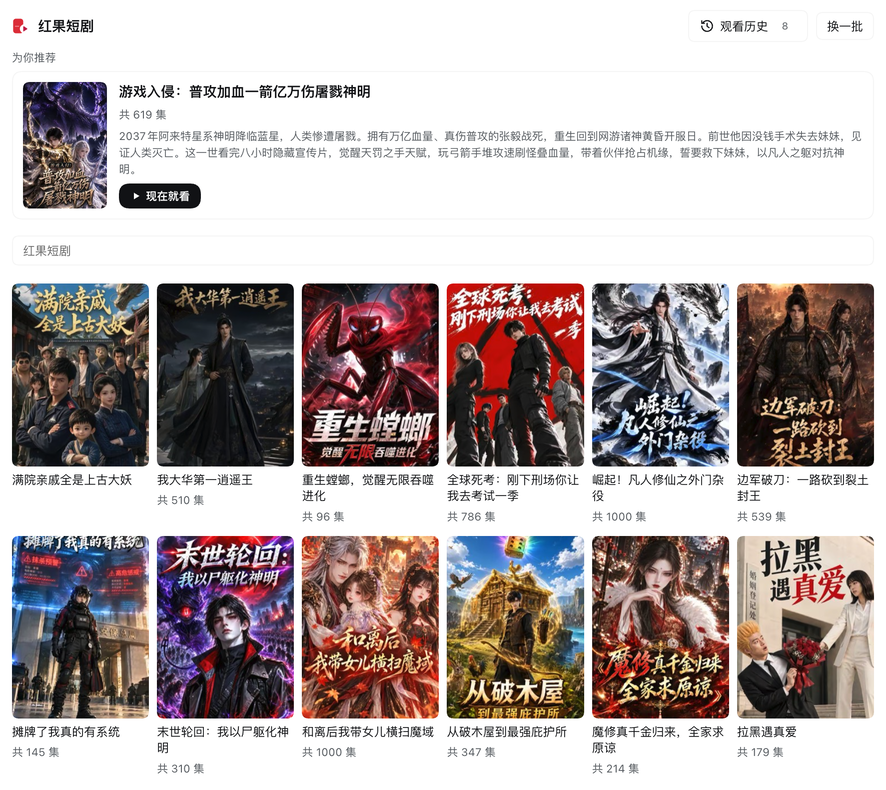
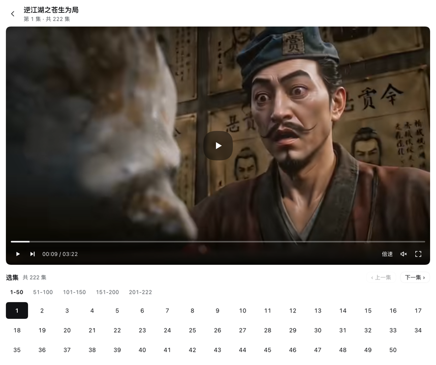
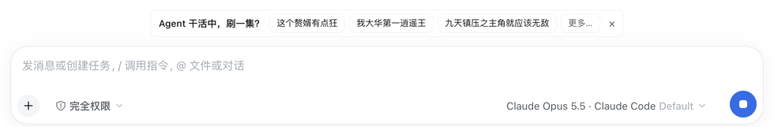

# dsh-hongguo

摸鱼短剧：一个 DSH 插件，在右侧边栏里播一部短剧，Agent 干活的时候提示你把它调出来。

数据来自 [openhongguo](https://github.com/beilunyang/openhongguo)（第三方短剧平台的非官方 SDK，匿名设备、无需登录）。请仅用于个人学习与研究，内容版权归权利人所有。

## 安装

npm 上的 `dsh-hongguo` 不是本插件，请从 GitHub 安装：

```sh
dsh plugin add github:frostming/dsh-hongguo
```

依赖 `openhongguo` 会从 npm 一并安装。

> 本仓库是个人 fork：新增浏览器播放页、倍速选择、滚轮调音量与画中画。上游项目见 [frostming/dsh-hongguo](https://github.com/frostming/dsh-hongguo)。

## 在浏览器里播放

右侧边栏的标签页属于**当前这个对话**：切到别的对话，标签页会卸载，正在播的那一集也就停了。想让它一直播，就把播放交给浏览器里的播放页（Host 用 `/api/hongguo/window` 提供这个页面），它有自己的文档，切对话、换侧栏布局、刷新 DSH 都不受影响。

打开方式：点播放器标题栏右侧的 ↗（列表页是 `默认浏览器打开`）。DSH 桌面外壳会拦掉页面里的 `window.open`，所以由 **Host 调用系统默认浏览器**（`POST /api/hongguo/open`，URL 由 Host 自己拼，只接受剧集 id 和播放秒数）；Host 和浏览器不在同一台机器时退回页面自己的 `window.open`。

播放页具备：剧集列表、搜索、`换一批`、分集（50 集一段）、原生控件、画质切换、倍速、画中画、滚轮调音量、**一集放完自动接下一集并自己接着播**、续播（与边栏共用同一份播放记录）、以及「Agent 停下时自动暂停」。
## 截图

**剧集列表**：顶部推荐一部没看过的热门剧，下面每页 12 部，`换一批` 翻页；`观看历史` 点开才显示。



**播放器**：画面按视频比例自适应，画面内控制条（进度拖动、下一集、倍速、静音、全屏），选集按 50 集分段。



**等待提示**：Agent 运行时在输入框上方出现，点剧名直接开播，`更多…` 打开播放器。



## 功能

| 位置 | 内容 |
|---|---|
| 右侧边栏 | `摸鱼短剧` 标签页：推荐卡片 + 剧集列表（带封面、服务端搜索、可翻页）→ 分集 → 播放器 |
| 搜索 | 走红果接口而不是过滤已加载的列表；首屏自动补到 12 部，`换一批` 沿游标继续取，结果按 id 去重 |
| 剧集列表 | 按面板宽度自适应：每行 6 / 4 / 3 / 2 部，每页 12 部，`换一批` 翻到下一页 |
| 播放历史 | 记住每部剧看到第几集、第几秒；`观看历史` 按钮点开后一键续播，可单条移除 |
| 左侧栏底部 | `短剧` 按钮，一键打开播放器 |
| 输入框上方 | Agent 运行时出现浮框：3 部剧可直接点开，`更多…` 打开播放器；当前页面已显示播放器时不出现 |
| 任务完成 | Agent 从运行变为空闲时自动暂停正在播放的短剧，并在画面上提示 |
| 侧边栏引导页 | 一个 `摸鱼短剧` 入口卡片 |
| 播放器 | 画面内控制条、倍速选择（0.5–2×）、画中画、全屏、自动连播下一集、续播提示 |
| 音量 | 鼠标滚轮在画面上调音量，调的时候画面里显示当前音量与进度条，数值记在浏览器里（边栏与播放页共用） |
| 自动连播 | 一集播完自动接下一集，并且**下一集自己开播**，不用再点一下 |
| 播放页 | 在浏览器里打开完整播放器（同样的路由与播放记录），切换对话不会打断 |
| 画中画 | 视频级 PiP；边栏播放器和播放页里各有一个按钮 |

## 结构

- **Host 半（`index.js`）**：加载 openhongguo SDK、维护匿名设备档案，提供同源路由 `/api/hongguo/{feed,series,play,search,media,stream,hghub-manifest,playlist,config,open,running,activity}`、`/api/hongguo/cover`、`/api/hongguo/vendor` 与 `/api/hongguo/window`（浏览器里的播放页）。启动时预先拉取剧集列表。CDN 只提供 HEIC 封面，Host 用 `sips`（macOS）或 `ffmpeg`（其他平台）转成 JPEG 并缓存。
- **备用片源（`sdk/hghub/`）**：一份不依赖第三方包的客户端，见 [`sdk/hghub/README.md`](sdk/hghub/README.md)。它按 [Minireel/HGhub](https://github.com/Minireel/HGhub) 的做法对接「单一信封接口」：站点把全部 `/api/**` 收敛成一个 `POST /api/edge/request`，客户端只往里填 `path`——不签名、不登录、也不建任何设备档案。默认片源仍是红果，`source: hghub` 才切过去。
- **Client 半（`client.js`）**：注册侧边栏标签页类型 `hongguo`、侧栏底部按钮、`conversation.input.dock` 里的等待提示，以及把播放交给浏览器的 ↗ 按钮。
- **播放页（`standalone/`）**：一个不依赖 DSH React 运行时的页面（`index.html` + `app.js` + `app.css`），只调用上面那些同源路由；播放位置与音量写在与边栏相同的 localStorage 记录里，两边互通。

## 播放与解密

视频是 CENC（cenc-aes-ctr）加密的 HEVC，浏览器无法直接解码（这是 `hongguo` 片源）。Host 用 SDK 解析出的内容密钥调用本机 `ffmpeg` 解密并重封装为普通 MP4（`-c copy`，不重编码），缓存在插件数据目录 `media/`（保留最近 40 集）。页面只拿到同源 `/api/hongguo/media` 地址，密钥不出 Host。

需要安装 ffmpeg：macOS `brew install ffmpeg`，Windows `winget install Gyan.FFmpeg`，其他平台用系统包管理器安装。封面转换复用同一个 ffmpeg，所以在 Windows / Linux 上没有 ffmpeg 时海报会显示占位图。

`hghub` 片源走的是另一条路：标准 HLS + AES-128，`#EXT-X-KEY` 指向 CDN 上的 16 字节密钥。
Host 只改写 m3u8（把分片与 key 指向同源 `/api/hongguo/stream`），**不解密**——
hls.js 自己向 CDN 取密钥并解密。所以这条路不需要 ffmpeg，也不占 `media/` 缓存；
封面是 AES-128-CBC 密文，Host 直接解密，同样不需要 ffmpeg。

## 配置

`cordis.patch.yml` 中 `hongguo` 行的 `config`：

| 字段 | 默认 | 说明 |
|---|---|---|
| `autoPrompt` | `true` | Agent 运行时是否显示提示 |
| `panelWidth` | `480` | 保留字段：右侧边栏宽度由 DSH 自己管理，当前版本不生效 |
| `source` | `hongguo` | 默认片源：`hongguo`（红果）或 `hghub`（备用）。单条请求可用 `?source=` 覆盖 |
| `profilePath` | 插件数据目录 | 匿名设备档案文件；删除即更换设备 |
| `searchTerms` | `总裁/重生/逆袭` | 推荐不足时补充列表用的搜索词 |

## 本 fork 的改动

在 `frostming/dsh-hongguo` 基础上的加固与修复：

**安全**

- `/api/hongguo/*` 是绕过 DSH 认证 `/api` 桥的裸前缀路由，现在要求 `Host` 头指向本机服务本身（含 `127.0.0.1` / `localhost` / `[::1]` 别名）。DNS rebinding 的页面无法伪造该头。
- `/stream` 不再回 `Access-Control-Allow-Origin: *`；转发上游 `Content-Type` 前先过滤，非媒体类型一律降级为 `application/octet-stream` 并加 `Content-Disposition: attachment`，同时补 `X-Content-Type-Options: nosniff`，避免把 CDN 内容当同源文档执行。
- `/stream`、`/cover`、HLS/DASH 子清单、以及解密下载都重新校验跳转后的域名，不再只信任第一个 URL 的白名单结论。
- `/config` 不再返回 `profilePath` 绝对路径。
- `sips` 增加 15s 超时；封面缓存上限 300 张；ffmpeg 并发上限 2。

**功能修复**

- `/playlist` 修复：缓存里存的是 `{body,type}`，旧代码读 `entry.url` 导致每次必失败。
- `.mjs` 按 `text/javascript` 返回：Chromium 拒绝非 JS MIME 的动态 `import()`，DASH 因此永远加载不了。
- HLS 分支引用了未定义的 `onMediaError`，改为已有的 `failOnMedia`；DASH 用不存在的 `MediaPlayer.isSupported` 做前置检查，改为判断 `MediaSource` 是否存在。
- `autoPrompt` 现在真的生效（客户端读取 `/config` 后决定是否渲染等待提示）。
- 新增 `POST /api/hongguo/activity`，客户端的上报不再 404。
- 数据目录支持 `$DSH_HOME`（原先硬编码 `~/.dsh`）。

已知限制：`panelWidth` 无公开 API 可设（侧边栏自己管宽度）；`/media`、`/stream` 等路由本身仍需登录校验，仅靠 Host 头与 loopback 绑定防护，请勿把 DSH 暴露到局域网或反代出去。

## 测试

```bash
npm install          # 需要 node_modules/openhongguo
npm test             # 路由级断言，不需要网络（插件启动时的 feed 预热除外）
npm run test:media   # 真实 SDK + ffmpeg 解密一集，需要网络与 ffmpeg
```

`test/route-check.mjs` 用假 `ctx` 调用真实的 `apply()`，再把真实路由 handler 打一遍，覆盖 Host 头校验、`.mjs` MIME、目录穿越、`/stream` 白名单、`/activity`、`/playlist` 空缓存等 11 项断言。

`test/media-check.mjs` 走 `feed → series → play → media` 全链路，校验解密产物是合法 MP4（`ftyp` 头），结束时只清掉自己写入的缓存，原本已存在的那一集不动。
